# LEDGER — 账本世界模型（机械生成，勿手改）

> 由 `tools/digest.py` 生成于账本状态 7G/35D/53O/47E。变更账本后必须重跑；`--check` 漂移即 CI 红灯。
> AI 会话入口：本文件 + `AGENTS.md` + `CONSTITUTION.md` + `thinking/`。

## 目标账

| 目标 | 内容 | 验收 |
|---|---|---|
| G-001 | 正确性——元素恰好一次、按序交付 | O-013, O-014, O-017, O-028, O-030 |
| G-002 | 并发安全——无竞争、无死锁、必然苏醒 | O-011, O-012, O-016 |
| G-003 | 性能预算——聚合吞吐与尾延迟 | O-015 |
| G-004 | 可复验的 AI 辅助工程纵切 | O-035 |
| G-005 | 本地增量保证 CLI | O-036, O-037 |
| G-006 | 仓库自我验证与版本发布流程 | O-038, O-039 |
| G-007 | 智能体工程闭环的迭代样本 | O-040, O-041, O-042, O-043, O-044, O-045, O-046, O-047 |

## 活跃决策

| 决策 | 状态 | 问题 → 选择 | 服务 |
|---|---|---|---|
| D-002 | accepted | 队列的值语义与 API 形态？ → T 按值进出；pop 用出参；不暴露任何指向内部存储的引用或指针 | G-001 |
| D-003 | accepted | MPMC 的并发策略？ → 单 mutex + not_empty/not_full 两个条件变量，阻塞式 push/… | G-002, G-003 |
| D-004 | accepted | 容量策略？ → 构造时固定 capacity；无界与动态增长被否决 | G-001 |
| D-005 | accepted | 测试与证据策略？ → 单元 + 关闭/背压时序测试 + 4x4 压力（逐操作不变量断言）+ 吞吐基准；TSAN … | G-001, G-002, G-003 |
| D-006 | accepted | 协议级与证明级检查器引入哪些？（TLA+ / Verus / Lean4） → TLA+ 与 Verus 并采——TLA+ 管协议层安全+liveness，Verus 管… | G-002 |
| D-007 | accepted | 工作流主语言与试点实现载体？ → Rust 为工作流主语言；试点以 Rust 重写为 pilot-rs；C/C++/Pyth… | G-001, G-002, G-003 |
| D-008 | accepted | 原 C++ 试点的处置？ → 归档保留——第二/备选语言的现役示例与跨语言对照材料；不再演进，其义务证据为历史记录 | G-001, G-002, G-003 |
| D-009 | accepted | Rust 主实现的 MPMC 并发策略？（C++ 归档实现的对应决策见 D-0… → std::sync::Mutex + 两把 Condvar，阻塞式 push/pop，cl… | G-002, G-003 |
| D-010 | accepted | Rust 主实现的值语义与容量策略？（C++ 对照见 D-002 / D-00… → T 按 move 进出，pop 返回 Option<T>；固定容量；不暴露任何内部引用 | G-001 |
| D-011 | accepted | 运行时诊断/调试档是否引入？用什么工具？ → 引入运行时诊断档，起步用机器现成的 cdb（Rust/MSVC/PDB）与 gdb（C++… | G-002 |
| D-013 | accepted | G-003 v1（synthetic 的 p99<10µs 预算）如何处置？—… → 方案A——撤回预算。G-003 v1 确认为实验道具（未锚定任何下游需求），红线解除，零优… | G-003 |
| D-014 | accepted | 是否引入"思维库"（盲区判例法 + 方法库）作为账本之外的元认知层？ → 引入 thinking/blind_spots.md（10 条判例）与 thinking/… | G-001, G-002, G-003 |
| D-015 | accepted | 守门人自身如何可信化？（lint 自测、路径配置收敛、检查器运行器） → 三件套并做——ledger_lint 拆出可导入校验函数并配黄金用例自测（含 L1 扩展到… | G-001, G-002 |
| D-016 | accepted | 模型↔代码一致性靠什么维持？（BS-010 承认的"评审+快照"薄墙如何硬化） → 机械对账检查器——ledger/bridge.yaml 登记模型常量/被检性质/语义点三张… | G-001, G-002 |
| D-017 | accepted | Verus 证明对象与运行实现是两份结构（proofs/queue_core.… → 契约门控——队列核心抽取为 pilot-rs/src/qcore.rs（无锁纯数据流），V… | G-001, G-002 |
| D-018 | accepted | 检查器如何从本机脚本升级为可托付工程物？（CI / 世界模型摘要 / 文档收敛… → 四件套——GitHub Actions 四档并跑（ledger/rust/tla/veru… | G-001, G-002, G-003 |
| D-019 | accepted | timed_pop（限时取）如何进入主实现？（实验 A 载体，experime… → Condvar::wait_timeout + 谓词循环——与 pop() 完全同构的 w… | G-001, G-002 |
| D-020 | accepted | 是否收编《推理方法论》手稿（2026-08/09 六文件，thinking/m… → 收编（手册存于 thinking/methodology/，随 git 锁定），三步合并按… | G-001, G-002, G-003 |
| D-021 | accepted | 强制层如何本地化？（仓库无 remote，CI 从未运行；pre-commit… → 三件——.githooks/pre-commit 升级为四合一门薄壳（账目 lint / … | G-001, G-002 |
| D-022 | accepted | 术语与命名如何治理？（词表漂移两次、收编手册编号撞名已产生真实错引、ancho… → glossary 词表 + 命名空间前缀读法 + anchor 存在性 lint——thi… | G-001, G-002, G-003 |
| D-023 | accepted | 义务与目标的生命周期如何结构化？（9 条永久 WARN 钝化、O-021/O-… → 四字段——义务出身 origin（tool|trigger；satisfies 与 ori… | G-001, G-002, G-003 |
| D-024 | accepted | 引擎立项前置包——哪些必要工作现在做？（schema 增量、实验 D、spec… → 三件——(1) 账本 schema 增量：D 账 assumptions[]（每条 tex… | G-001, G-002 |
| D-025 | accepted | 统一底层工具的吸收战略如何操作化？（吸收语义/协议/格式、验证器保持叶子——统… → M2 协议吸收第一片——spec check 子命令：复用 ledger_check 分发… | G-001, G-002 |
| D-026 | draft | 元认知层与跨仓约束的三处缺口如何补？（①盲区库停在"评审清单"档而非"门"；②… → 一条元决策承载三件，全部是结构性对策，不改动 pilot 代码——(1) 盲区库从"清单"… | G-001, G-002, G-003 |
| D-027 | accepted | 盲区库如何从"评审清单"升为"门"——使新增不变量级检查器**不可能**在未知… → 三件——(1) 义务 schema 增必填字段 bs_guard（判例 id 列表）与配套… | G-001, G-002, G-003 |
| D-028 | accepted | 如何把 Spec Ledger 与 Assay 整合成同一工程入口，并用真实项… → 把 Spec Ledger 当前工作树（含其未提交修改）合入 Assay 的单一 Git … | G-004 |
| D-029 | accepted | Assay 的第一个增量保证 CLI 版本应提供什么能力和边界？ → 第一版继续以 engine/ 下的 Rust 可执行程序作为 Assay CLI，目标工程… | G-005 |
| D-030 | accepted | Assay 仓库如何自我验证、管理发布，并界定外部研究材料的归属？ → 通过 GitHub Actions 对 Assay CLI、Rust 试点、示例、Spec… | G-006 |
| D-031 | accepted | 在 Assay examples 中增加什么小型真实计算项目，以检验智能体协作… → 在 examples/parallel-histogram 实现无第三方依赖的 Rust … | G-007 |
| D-032 | accepted | 如何把现有并行直方图示例迭代成包含调度与运行边界的真实小型系统？ → 继续在 examples/parallel-histogram 内演进，不增加第二个示例。… | G-007 |
| D-033 | draft | 仓里已经有协议（PROTOCOL）、引擎（Rust 哑执行器）、账本工具（7 … → 入口做进引擎：新增只读子命令 `doctor`（就绪度诊断）与 `next`（有序动作表）… | G-005, G-007 |
| D-034 | draft | 常驻注入的 `AGENTS.md` 没有预算，也没有任何东西阻止它驻留机器相关… → 最后一项：新增 `RUNBOOK.md`（按需加载，承载命令/路径/版本），`AGENTS… | G-005, G-007 |
| D-035 | draft | 本仓库的 CI（`.github/workflows/ci.yml` 与 `r… → 暂时整体移除两个 workflow，并在 README / engine/README /… | G-006 |

## 历史决策

| 决策 | 状态 | 去向 |
|---|---|---|
| D-001 | superseded | superseded_by=D-007 |
| D-012 | superseded | superseded_by=D-013 |

## 义务与证据

| 义务 | 描述 | 检查器档 | 证据 | 所属 |
|---|---|---|---|---|
| O-001 | 任何公共 API 不得让内部元素的引用或指针逃逸 | lint | 历史 | D-002 |
| O-002 | 元素拷贝或移动抛异常时，队列状态不破坏 | manual | 历史 | D-002 |
| O-003 | 不存在数据竞争 | test | 历史 | D-003 |
| O-004 | 不产生死锁 | lint | 历史 | D-003 |
| O-005 | 每个操作后 0 <= size <= capacity | test | 历史 | D-003 |
| O-006 | 交付保序——每个生产者的元素按其推送顺序被交付（总 FIFO 的可检验形式） | test | 历史 | D-003 |
| O-007 | 聚合吞吐满足 G-003 预算 | bench | 历史 | D-003 |
| O-008 | 两处 wait 均为谓词循环，虚假唤醒与关闭唤醒正确 | manual | 历史 | D-003 |
| O-009 | close 唤醒全部阻塞者；排空后 pop 返回 false；关闭后 push 返回 … | test | 历史 | D-003 |
| O-010 | 队满时 push 阻塞，消费释放容量后苏醒完成推送 | test | 历史 | D-004 |
| O-011 | 不存在数据竞争 | lint | pass | D-009 |
| O-012 | 不产生死锁 | lint | pass | D-009 |
| O-013 | 每个操作后 0 <= size <= capacity | test | pass | D-009 |
| O-014 | 交付保序——每个生产者的元素按其推送顺序被交付（总 FIFO 的可检验形式） | test | pass | D-009 |
| O-015 | 聚合吞吐满足 G-003 预算 | bench | pass | D-009 |
| O-016 | 两处谓词循环等待，虚假唤醒与关闭唤醒正确 | manual | pass | D-009 |
| O-017 | close 唤醒全部阻塞者；排空后 pop 返回 None；关闭后 push 返回 f… | test | pass | D-009 |
| O-018 | 队满时 push 阻塞，消费释放容量后苏醒完成推送 | test | pass | D-010 |
| O-019 | 内部存储的引用或指针不通过 API 逃逸 | lint | pass | D-010 |
| O-020 | 元素 drop 或移动发生 panic 时队列状态不破坏（panic 安全） | manual | deferred | D-010 |
| O-021 | Verus 证明 BoundedQueue 顺序核心（状态不变量 + push/pop… | proof | 历史 | D-006 |
| O-022 | 崩溃/断言失败/abort 时自动产出结构化证据（异常 + 符号化 backtrace… | test | pass | D-011 |
| O-023 | close/关停路径断点快照（命中记录 + 符号化调用链）可一键复现 | test | pass | D-011 |
| O-024 | push 阻塞延迟（含唤醒）p99 < 10µs @ 4生产者/4消费者（消费者每次 … | bench | 历史 | D-012 |
| O-025 | 模型↔代码桥对账全绿——常量登记、性质认领、语义点符号三向存在（B1/B2/B3） | lint | pass | D-016 |
| O-026 | ledger_lint 黄金用例自测全绿（好账/坏账/L1-L3/触发器覆盖/豁免各档） | test | pass | D-015 |
| O-027 | ledger_check 可解析全部已知 checker 类型并对可执行档实际复跑（-… | test | pass | D-015 |
| O-028 | Verus 证明对象=实现本体——qcore.rs 的 inv/qnew/push/p… | proof | pass | D-017 |
| O-029 | LEDGER.md 由 digest 机械生成且与账本状态零漂移（CI 档强制） | lint | pass | D-018 |
| O-030 | timed_pop 谓词循环唤醒正确——超时返回 None 且队列状态不变；虚假唤醒安… | test | pass | D-019 |
| O-031 | timed_pop 的关闭语义——阻塞中 close 立即唤醒返回 None（不耗尽 … | test | pass | D-019 |
| O-032 | pre-commit 强制门四合一——账目 lint / 桥对账 / digest 新… | test | pass | D-021 |
| O-033 | 证据复跑档本机可执行——config python 路径经 cmd.exe 可调用，l… | test | pass | D-021 |
| O-034 | 每条义务声明其防护判例——bs_guard 为判例 id 列表，引用必须真实存在于判例… | lint | pass | D-027 |
| O-035 | 示例验证命令必须从新项目初始化、账本检查、Rust 测试、Assay 检查/运行到证据… | test | pass | D-028 |
| O-036 | 本地计划必须基于明确 base 的 Git 差异；登记输入范围命中时选择相应检查，未登… | test | pass | D-029 |
| O-037 | CLI 提供可测试的帮助、版本、版本信息子命令和无效参数错误；Cargo 包版本与清单… | test | pass | D-029 |
| O-038 | GitHub 工作流在 Linux/Windows 上验证 Rust 产物与 Assa… | manual | deferred | D-030 |
| O-039 | 下载论文和实现调研速记保持 Git 忽略；共享工具配置不绑定开发机绝对路径，并由自动化… | test | pass | D-030 |
| O-040 | 并行直方图对空输入、完整字节域、分块边界及多种 worker 数产生与串行 oracl… | test | pass | D-031 |
| O-041 | release benchmark 能在可配置输入大小和 worker 数下运行，打印… | test | pass | D-031 |
| O-042 | 示例 Assay 清单将功能等价声明绑定到可运行 Rust 测试，且 Assay ch… | test | pass | D-031 |
| O-043 | 仓库端到端脚本能对该示例执行 Rust 测试、Assay run/check/map，… | test | pass | D-031 |
| O-044 | 有界流水线 TLA+ 模型通过 TLC 检查队列不超过容量、每项工作在任一时刻至多处于… | test | pass | D-032 |
| O-045 | 流式流水线对任意测试字节输入与串行 oracle 一致，队列容量为 1 时仍完成；短读… | test | pass | D-032 |
| O-046 | CLI 可从文件运行并输出机器可读的完整 256 桶结果；无效参数、缺失文件和运行失败… | test | pass | D-032 |
| O-047 | Assay 清单覆盖流式行为、TLA+ 模型与 CLI；CI 和端到端脚本运行其测试、… | test | pass | D-032 |
| O-048 | `assay doctor` 报出清单里声明的命令首词解析不到，并**点名**是哪个检… | lint | 缺失 | D-033 |
| O-049 | `assay next` 报出"证据与当前检查定义不符"并给出**具体**原因（命令已… | lint | 缺失 | D-033 |
| O-050 | L1 的产物全集由 git 定义（.gitignore 说了算）：未跟踪且未忽略的新文… | lint | 缺失 | D-033 |
| O-051 | 唯一入口 `assay`（tools/assay-cli.ps1 + assay.cm… | manual | 缺失 | D-033 |
| O-052 | 常驻注入的 AGENTS.md 不超过机器判定的字符上限，且不含机器相关的命令头（解释… | lint | 缺失 | D-034 |
| O-053 | 仓库内不存在指向已删除 workflow 的引用或产物登记：README / engi… | lint | 缺失 | D-035 |

## 触发器库

- `blocking_api`：2 条规则（wakeup_correctness, shutdown_semantics）
- `fixed_capacity`：1 条规则（backpressure_policy）
- `shared_mutable_state`：5 条规则（race_freedom, deadlock_freedom, ordering_semantics, invariant_protection, contention_budget）
- `value_type_copy`：2 条规则（exception_safety, ownership_boundary）

## 模型↔代码桥

- 模型常量 4（合成道具）| 不变式/性质锚点 5 | 语义点 8（verus 覆盖 5/8）
- 对账命令：`python tools/bridge_check.py`（义务 O-025）

## 元认知库

- 盲区判例 13 条（`thinking/blind_spots.md`）| 方法 12 条（`thinking/methods.md`）

## 活跃拓扑

```mermaid
flowchart LR
    G-001(('G-001'))
    G-002(('G-002'))
    G-003(('G-003'))
    G-004(('G-004'))
    G-005(('G-005'))
    G-006(('G-006'))
    G-007(('G-007'))
    D_002['D-002']
    G-001 --> D_002
    D_002 --> O_001
    D_002 --> O_002
    D_003['D-003']
    G-002 --> D_003
    G-003 --> D_003
    D_003 --> O_003
    D_003 --> O_004
    D_003 --> O_005
    D_003 --> O_006
    D_003 --> O_007
    D_003 --> O_008
    D_003 --> O_009
    D_004['D-004']
    G-001 --> D_004
    D_004 --> O_010
    D_005['D-005']
    G-001 --> D_005
    G-002 --> D_005
    G-003 --> D_005
    D_006['D-006']
    G-002 --> D_006
    D_006 --> O_021
    D_007['D-007']
    G-001 --> D_007
    G-002 --> D_007
    G-003 --> D_007
    D_008['D-008']
    G-001 --> D_008
    G-002 --> D_008
    G-003 --> D_008
    D_009['D-009']
    G-002 --> D_009
    G-003 --> D_009
    D_009 --> O_011
    D_009 --> O_012
    D_009 --> O_013
    D_009 --> O_014
    D_009 --> O_015
    D_009 --> O_016
    D_009 --> O_017
    D_010['D-010']
    G-001 --> D_010
    D_010 --> O_018
    D_010 --> O_019
    D_010 --> O_020
    D_011['D-011']
    G-002 --> D_011
    D_011 --> O_022
    D_011 --> O_023
    D_013['D-013']
    G-003 --> D_013
    D_014['D-014']
    G-001 --> D_014
    G-002 --> D_014
    G-003 --> D_014
    D_015['D-015']
    G-001 --> D_015
    G-002 --> D_015
    D_015 --> O_026
    D_015 --> O_027
    D_016['D-016']
    G-001 --> D_016
    G-002 --> D_016
    D_016 --> O_025
    D_017['D-017']
    G-001 --> D_017
    G-002 --> D_017
    D_017 --> O_028
    D_018['D-018']
    G-001 --> D_018
    G-002 --> D_018
    G-003 --> D_018
    D_018 --> O_029
    D_019['D-019']
    G-001 --> D_019
    G-002 --> D_019
    D_019 --> O_030
    D_019 --> O_031
    D_020['D-020']
    G-001 --> D_020
    G-002 --> D_020
    G-003 --> D_020
    D_021['D-021']
    G-001 --> D_021
    G-002 --> D_021
    D_021 --> O_032
    D_021 --> O_033
    D_022['D-022']
    G-001 --> D_022
    G-002 --> D_022
    G-003 --> D_022
    D_023['D-023']
    G-001 --> D_023
    G-002 --> D_023
    G-003 --> D_023
    D_024['D-024']
    G-001 --> D_024
    G-002 --> D_024
    D_025['D-025']
    G-001 --> D_025
    G-002 --> D_025
    D_026['D-026']
    G-001 --> D_026
    G-002 --> D_026
    G-003 --> D_026
    D_027['D-027']
    G-001 --> D_027
    G-002 --> D_027
    G-003 --> D_027
    D_027 --> O_034
    D_028['D-028']
    G-004 --> D_028
    D_028 --> O_035
    D_029['D-029']
    G-005 --> D_029
    D_029 --> O_036
    D_029 --> O_037
    D_030['D-030']
    G-006 --> D_030
    D_030 --> O_038
    D_030 --> O_039
    D_031['D-031']
    G-007 --> D_031
    D_031 --> O_040
    D_031 --> O_041
    D_031 --> O_042
    D_031 --> O_043
    D_032['D-032']
    G-007 --> D_032
    D_032 --> O_044
    D_032 --> O_045
    D_032 --> O_046
    D_032 --> O_047
    D_033['D-033']
    G-005 --> D_033
    G-007 --> D_033
    D_033 --> O_048
    D_033 --> O_049
    D_033 --> O_050
    D_033 --> O_051
    D_034['D-034']
    G-005 --> D_034
    G-007 --> D_034
    D_034 --> O_052
    D_035['D-035']
    G-006 --> D_035
    D_035 --> O_053
    O_001[O-001]
    class O_001 hist
    O_002[O-002]
    class O_002 hist
    O_003[O-003]
    class O_003 hist
    O_004[O-004]
    class O_004 hist
    O_005[O-005]
    class O_005 hist
    O_006[O-006]
    class O_006 hist
    O_007[O-007]
    class O_007 hist
    O_008[O-008]
    class O_008 hist
    O_009[O-009]
    class O_009 hist
    O_010[O-010]
    class O_010 hist
    O_011[O-011]
    class O_011 ok
    O_012[O-012]
    class O_012 ok
    O_013[O-013]
    class O_013 ok
    O_014[O-014]
    class O_014 ok
    O_015[O-015]
    class O_015 ok
    O_016[O-016]
    class O_016 ok
    O_017[O-017]
    class O_017 ok
    O_018[O-018]
    class O_018 ok
    O_019[O-019]
    class O_019 ok
    O_020[O-020]
    class O_020 def
    O_021[O-021]
    class O_021 hist
    O_022[O-022]
    class O_022 ok
    O_023[O-023]
    class O_023 ok
    O_024[O-024]
    class O_024 hist
    O_025[O-025]
    class O_025 ok
    O_026[O-026]
    class O_026 ok
    O_027[O-027]
    class O_027 ok
    O_028[O-028]
    class O_028 ok
    O_029[O-029]
    class O_029 ok
    O_030[O-030]
    class O_030 ok
    O_031[O-031]
    class O_031 ok
    O_032[O-032]
    class O_032 ok
    O_033[O-033]
    class O_033 ok
    O_034[O-034]
    class O_034 ok
    O_035[O-035]
    class O_035 ok
    O_036[O-036]
    class O_036 ok
    O_037[O-037]
    class O_037 ok
    O_038[O-038]
    class O_038 def
    O_039[O-039]
    class O_039 ok
    O_040[O-040]
    class O_040 ok
    O_041[O-041]
    class O_041 ok
    O_042[O-042]
    class O_042 ok
    O_043[O-043]
    class O_043 ok
    O_044[O-044]
    class O_044 ok
    O_045[O-045]
    class O_045 ok
    O_046[O-046]
    class O_046 ok
    O_047[O-047]
    class O_047 ok
    O_048[O-048]
    class O_048 miss
    O_049[O-049]
    class O_049 miss
    O_050[O-050]
    class O_050 miss
    O_051[O-051]
    class O_051 miss
    O_052[O-052]
    class O_052 miss
    O_053[O-053]
    class O_053 miss
    classDef ok fill:#d4edda,stroke:#3c763d
    classDef def fill:#fff3cd,stroke:#856404
    classDef miss fill:#f8d7da,stroke:#a94442
    classDef hist fill:#e2e3e5,stroke:#6c757d,stroke-dasharray: 5 5
```

