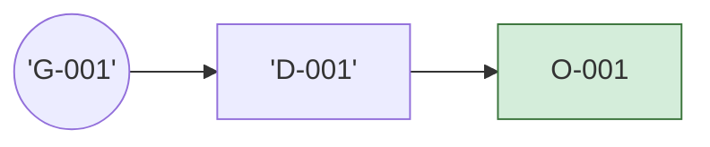

# LEDGER — 账本世界模型（机械生成，勿手改）

> 由 `tools/digest.py` 生成于账本状态 1G/1D/1O/1E。变更账本后必须重跑；`--check` 漂移即 CI 红灯。
> AI 会话入口：本文件 + `AGENTS.md` + `CONSTITUTION.md` + `thinking/`。

## 目标账

| 目标 | 内容 | 验收 |
|---|---|---|
| G-001 | Create and retrieve one valid in-memory record | O-001 |

## 活跃决策

| 决策 | 状态 | 问题 → 选择 | 服务 |
|---|---|---|---|
| D-001 | accepted | What is the smallest user-observable se… → Implement a synchronous Service::create/get A… | G-001 |

## 义务与证据

| 义务 | 描述 | 检查器档 | 证据 | 所属 |
|---|---|---|---|---|
| O-001 | Valid create/read behavior is normalized; b… | test | pass | D-001 |

## 触发器库

- `blocking_api`：2 条规则（wakeup_correctness, shutdown_semantics）
- `fixed_capacity`：1 条规则（backpressure_policy）
- `shared_mutable_state`：5 条规则（race_freedom, deadlock_freedom, ordering_semantics, invariant_protection, contention_budget）
- `value_type_copy`：2 条规则（exception_safety, ownership_boundary）

## 元认知库

- 盲区判例 13 条（`thinking/blind_spots.md`）| 方法 12 条（`thinking/methods.md`）

## 活跃拓扑

